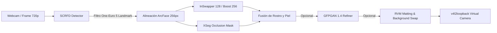

# 🎭 Real-Time Face Swap & Virtual Camera Streamer

<div align="center">

[](https://www.python.org/)
[](https://developer.nvidia.com/cuda-toolkit)
[](https://developer.nvidia.com/tensorrt)
[](https://onnxruntime.ai/)
[](https://github.com/umlaeute/v4l2loopback)

<p align="center">
  <strong>Intercambio facial ultrarrápido en tiempo real para webcam física con transmisión directa a cámara virtual (Zoom, Google Meet, Discord, OBS). Preserva tu cuerpo, manos reales y fondo nativo con segmentación de oclusiones y matting neuronal.</strong>
</p>

</div>

---

## ⚡ Enfoque Arquitectónico

A diferencia de los pipelines basados en animación completa de imagen estática (como LivePortrait), este proyecto sustituye **únicamente tu rostro** sobre el flujo de vídeo de tu webcam. Tu postura corporal, tus manos gesticulando y el fondo se mantienen intactos.

| Característica | Enfoque Avatar Completo (`avatar`) | Enfoque Face Swap (`faceswap`) |
| :--- | :--- | :--- |
| **Elemento Visible** | Retrato estático animado (ropa y fondo fijos). | Tu vídeo físico real con el rostro modificado. |
| **Interacción y Manos** | No interactúan dinámicamente. | Manos y micrófonos pasan frente al rostro con oclusión (`--occlusion`). |
| **Identidad** | Exacta a la imagen de referencia. | Fusión del rostro origen sobre tu geometría cefálica y peinado. |
| **Latencia** | Inferencia de difusión / warping (~30 FPS). | **Inferencia ONNX/TensorRT ultrarrápida (~27 ms por cuadro)**. |

---

## 🚀 Guía de Uso

Coloca las imágenes en `caras/` (una subcarpeta por persona), los vídeos de prueba en `videos/` y los fondos en `fondos/`. El selector los resolverá automáticamente por su identificador:

```bash
# Carga todas las imágenes de caras/miranda/ para promediar el embedding
python faceswap.py -s miranda

# Modo prueba con archivo de vídeo en bucle en lugar de la webcam
python faceswap.py -s miranda --input-video prueba.mp4

# Webcam 0 hacia cámara virtual (/dev/video2) con previsualización local
python faceswap.py -s cara.png

# + Restauración facial ultra nítida con GFPGAN 1.4
python faceswap.py -s cara.png --enhance

# Modo espejo para streaming cómodo
python faceswap.py -s cara.png --mirror

# Reemplazo de fondo inteligente con Robust Video Matting
python faceswap.py -s miranda -b playa.jpg

# Desenfoque de fondo dinámico (bokeh simulado)
python faceswap.py -s miranda -b blur
```

### Controles Rápidos en Teclado
- `q` : Salir de la aplicación.
- `Espacio` : Conmutar bypass instantáneo (verte a ti mismo sin swap).
- `e` : Alternar mejora GFPGAN.
- `p` : Alternar **Pixel Boost** (256 px).
- `o` : Activar/desactivar máscara de oclusión XSeg.
- `b` : Alternar cambio/desenfoque de fondo.
- `h` : Mostrar / ocultar telemetría y HUD de rendimiento en pantalla.

---

## ⚙️ Opciones de Línea de Comandos

| Opción | Descripción | Valor por Defecto |
| :--- | :--- | :--- |
| `-s`, `--source` | Imagen, carpeta o conjunto de fotos con el rostro de referencia | *(Obligatorio)* |
| `--occlusion` / `--no-occlusion` | XSeg detecta objetos frente al rostro (manos, micrófono, cabello) | `Activado` |
| `--enhance` / `--no-enhance` | Restaura y define el rostro con GFPGAN 1.4 | `Desactivado` |
| `--pixel-boost` / `--no-pixel-boost` | Genera a 256 px (4 pasadas InSwapper entrelazadas) | `Desactivado` |
| `--enhance-blend` | Factor de mezcla y suavizado de GFPGAN (0.0 a 1.0) | `0.8` |
| `-b`, `--background` | Reemplazo de fondo: ruta a imagen, vídeo en bucle o `blur` | Fondo real |
| `--many-faces` | Sustituye todos los rostros detectados en escena | `Desactivado` |
| `--det-size` | Resolución del detector SCRFD (`320` o `640`) | `640` |
| `--backend` | Motor de inferencia: `trt` (TensorRT FP16), `cuda` o `cpu` | `trt` preferido |
| `--width`, `--height` | Resolución de captura y emisión | `1280x720` |
| `-w`, `--webcam-id` | Identificador de cámara física o índice V4L2 | `0` |
| `-o`, `--output-device` | Dispositivo destino v4l2loopback para la cámara virtual | `/dev/video2` |
| `--no-preview` | Ejecución en segundo plano sin ventana local OpenCV | `Falso` |

> [!NOTE]
> La primera ejecución con `--backend trt` compila los motores TensorRT (aproximadamente 5 a 7 minutos). Quedarán cacheados en `models/trt_cache/`.

---

## 📊 Benchmark de Rendimiento (NVIDIA RTX 4070 Ti SUPER)

*Pruebas ejecutadas a resolución 1280x720 con detección facial activa:*

| Pipeline Stage | Backend CUDA | TensorRT FP16 |
| :--- | :---: | :---: |
| **Detector SCRFD (640)** | ~6 ms | **~3 ms** |
| **InSwapper 128** | ~7 ms | *(Opt. CUDA)* |
| **XSeg (Oclusión y Máscara)** | ~14 ms | *(Opt. CUDA)* |
| **GFPGAN 1.4 (Restauración)** | ~23 ms | *(Opt. CUDA)* |
| **Robust Video Matting (RVM)** | ~11 ms | *(Opt. CUDA)* |
| **TOTAL (Swap + Oclusión estándar)** | **~29 ms (~34 FPS)** | **~27 ms (~37 FPS)** |
| **TOTAL (+ GFPGAN Restauración)** | **~58 ms (~17 FPS)** | **~50 ms (~20 FPS)** |
| **TOTAL (Swap + Oclusión + RVM Fondo)** | **~40 ms (~25 FPS)** | **~40 ms (~25 FPS)** |

---

## 🛠️ Instalación y Requisitos

### 1. Entorno Virtual y Dependencias
```bash
# Crear entorno virtual con Python 3.11 (se recomienda uv)
uv venv -p 3.11 .venv
source .venv/bin/activate

# Instalar dependencias requeridas
uv pip install -r requirements.txt
```

### 2. Descarga Automatizada de Modelos
Ejecuta el script incluido para obtener los modelos ONNX oficiales:
```bash
chmod +x download_models.sh
./download_models.sh
```
El script descargará los siguientes pesos en la carpeta `models/`:
- `det_10g.onnx` & `w600k_r50.onnx` (InsightFace buffalo_l)
- `inswapper_128_fp16.onnx` (InSwapper)
- `gfpgan_1.4.onnx` (GFPGAN)
- `xseg_1.onnx` (FaceFusion occlusion)
- `rvm_mobilenetv3_fp32.onnx` (Robust Video Matting)

### 3. Habilitar Cámara Virtual en Linux
```bash
sudo modprobe v4l2loopback devices=1 video_nr=2 card_label="VirtualCam" exclusive_caps=1
```

---

## 🔬 Pipeline de Inferencia



---

## ⚖️ Licencia y Uso Ético

- Este proyecto incluye integraciones con **InSwapper**, cuyo modelo está destinado exclusivamente a investigación y propósitos no comerciales.
- Utiliza esta herramienta únicamente con identidades y rostros sobre los que poseas consentimiento explícito. No utilices este software para suplantación de identidad sin autorización.
